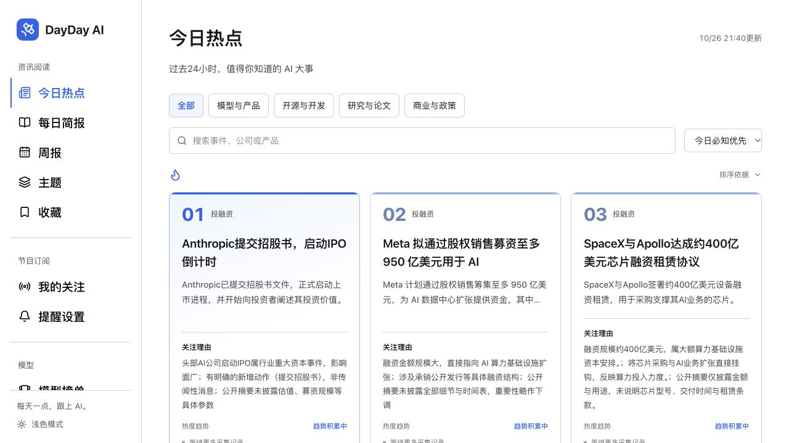
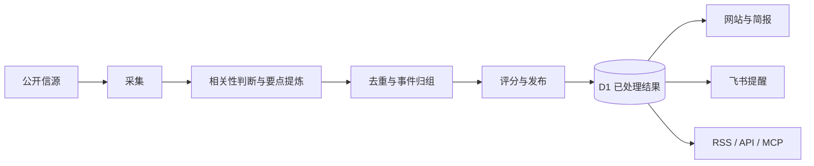

<p align="center">
  
</p>

<h1 align="center">DayDay AI</h1>

<p align="center"><strong>每天一点，跟上 AI。</strong><br>💡 一个替你关注信息源、筛选重要信息，并按你的设置推送到飞书的 AI 信息助理。</p>

<p align="center">
  <a href="https://dayday-ai.activecoot128.chatgpt.site">访问网站</a> ·
  <a href="#能做什么">功能介绍</a> ·
  <a href="#本地开发">本地开发</a> ·
  <a href="https://github.com/Avery-LIU88/dayday-ai/issues">反馈问题</a>
</p>

<p align="center">
  <a href="LICENSE"></a>
  
  
</p>



<p align="center"><sub>线上界面截图，摄于 2026-10-27；资讯内容以网站最新发布结果为准。</sub></p>

## 为什么做 DayDay AI

AI 信息散落在公司博客、论文平台、媒体、Newsletter 和节目里。同一件事常常被报道很多次，而一条重要的一手消息，未必已经被广泛转发。

DayDay AI 想帮你完成每天的第一轮筛选：**少看重复的信息，更快找到值得了解的新进展，并能追溯到原始来源。**

1. **给人阅读，也给 Agent 使用。** 通过网页和 RSS 阅读资讯，也能通过 API、MCP 让 Agent 查询已发布的事件与简报。
2. **自己选节目，更新推到飞书。** 关注 YouTube 频道、播客或支持的公开 RSS，按小时检查节目更新；也可开启今日热点和活动提醒，在每日更新完成后接收推送。
3. **开源可定制，搭建自己的信息站。** Fork 后调整信源、筛选提示词、分类和评分标准，再配置自己的部署环境，就可以围绕其他行业继续开发。

## 能做什么

| 功能 | 你可以怎样使用 |
| --- | --- |
| **今日热点** | 按“今日必知优先”浏览事件，查看一句话要点、关注理由、相关来源和报道热度趋势 |
| **每日简报 / 周报** | 按日期回看要闻，用较短时间补上错过的信息 |
| **主题 / 收藏** | 按主题、来源等条件查找内容，把想继续阅读的条目收藏起来 |
| **节目订阅** | 粘贴 Apple Podcasts、YouTube 频道或支持的公开 RSS 链接，关注更新，再前往原平台收听或观看 |
| **飞书提醒** | 连接自己的飞书群机器人，选择接收节目更新、今日热点和活动提醒 |
| **模型榜单** | 查看公开评测、图像 / 视频 / 语音榜单及部分模型的成本对比，保留数据来源与更新信息 |
| **Agent 接入** | 通过 RSS、公开 API、MCP 和 `llms.txt` 读取已经发布的资讯与简报 |

### 先用起来

1. 打开 [DayDay AI](https://dayday-ai.activecoot128.chatgpt.site)，免费阅读，无需注册。
2. 想追踪节目，在「我的关注」粘贴节目或频道链接，识别后确认关注。
3. 想收到推送，在「提醒设置」连接飞书自定义机器人，选择内容类别并开启提醒。

收藏保存在当前浏览器；关注和提醒通过当前浏览器的访问凭证管理，暂不跨设备同步。清除浏览器数据前，请先关闭不再需要的提醒。支持的链接范围见 [节目与提醒说明](docs/operations.md#节目与飞书提醒)。

## 如何筛选“值得知道”的信息

> 独立托管验收中：[新站](https://dayday-ai.lyc22686756.workers.dev)使用自有 Cloudflare 免费账户和新建 D1，从新数据开始。原定时器尚未切换，当前运行状态见[迁移记录](docs/hosting-migration.md)，独立部署命令见[部署说明](cloudflare/README.md)。



- **一件事，尽量只读一次。** 不同来源的报道归入同一事件；有实质新动作的后续进展单独关联。
- **重要性和热度分开看。** 首页综合考虑重要性、一手证据、报道覆盖与时效；报道数量不是唯一标准。
- **一手材料有明确权重。** 官方原始材料和直接支撑事件的原始链接会影响可靠性，但官方营销内容不会自动获得高重要性。
- **保留出处与判断依据。** 展示提炼后的要点和原文链接；页面、接口和分发读取同一份已发布结果。

筛选提示词、评分权重、阈值和模型预算集中在 [`config/pipeline.mjs`](config/pipeline.mjs)。具体规则见 [内容处理与排序](docs/content-pipeline.md)。

## 本地开发

需要 **Node.js 22.13 或更新版本**，以及 npm。

```bash
git clone https://github.com/Avery-LIU88/dayday-ai.git
cd dayday-ai
npm run install:ci
npm run dev -- --host 127.0.0.1 --port 4174
```

打开 <http://127.0.0.1:4174>。

这是本地开发入口。新环境不会自动获得线上数据、模型密钥或飞书配置；没有已发布的数据时，资讯区域会显示等待处理。要跑完整采集流程，还需配置自己的 D1、数据库表和服务端密钥，见 [开发与配置](docs/development.md)。

线上网站目前使用 **Sites 托管的 Cloudflare Workers + D1**，前端为 **React / TypeScript**，通过 **Vinext / Vite** 构建。仓库包含独立 Cloudflare 调度器，但完整站点尚未提供通用的一键部署流程。调度配置和验收步骤见 [独立调度说明](scheduler/README.md)。

## 按自己的需求调整

| 想调整什么 | 从哪里开始 |
| --- | --- |
| 信息源、发布者和一手来源标记 | [`data/news-sources.json`](data/news-sources.json)、[`data/source-overrides.json`](data/source-overrides.json) |
| AI 筛选、摘要、归组、评分和预算 | [`config/pipeline.mjs`](config/pipeline.mjs) |
| 活动清单与提醒节奏 | [`config/activities.mjs`](config/activities.mjs)、[`config/delivery.mjs`](config/delivery.mjs) |
| 站点对外链接和分发配置 | [`config/distribution.mjs`](config/distribution.mjs) |
| 页面、导航和视觉样式 | [`app/`](app/) |
| 独立定时调度 | [`scheduler/`](scheduler/) |

复用时请配置自己的站点、数据库和密钥，调整域名与品牌信息。`.openai/hosting.json` 中的项目 ID 属于当前线上站点，不是可直接复用的部署凭证。

## 文档与当前边界

| 文档 | 内容 |
| --- | --- |
| [开发与配置](docs/development.md) | 本地环境、配置位置、数据库、校验命令与分发入口 |
| [内容处理与排序](docs/content-pipeline.md) | 信源、模型分析、事件归组、一手证据、评分与成本控制 |
| [运行与提醒](docs/operations.md) | 更新节奏、后台检查、节目订阅、飞书回执与异常处理 |
| [独立调度](scheduler/README.md) | Cloudflare Cron + Workflow 的部署、切换和验收 |

项目持续迭代中：信源列入配置不代表已经稳定接通，实际状态以最近成功时间和失败原因判断；模型摘要与事件归组也可能出错，重要信息请核对原文。网站读取公开资料并展示提炼要点，不提供付费全文转载。

## 反馈与贡献

欢迎通过 [GitHub Issues](https://github.com/Avery-LIU88/dayday-ai/issues) 或网站「反馈」提交问题、信源建议和功能想法。

反馈内容错误时，请附上事件标题或原文链接；反馈功能故障时，请附上操作步骤和预期结果。提交截图或日志前，请移除 API Key、飞书 Webhook 等私人信息。

也欢迎提交 Pull Request。较大的功能调整建议先通过 Issue 说明目标，涉及业务逻辑的修改请附上验证方式。

## 致谢与许可

本项目代码与自行编写的文档采用 [MIT 许可证](LICENSE)：允许使用、修改、分发和商业使用，须保留版权声明与许可证。

第三方组件、数据、文章与图标保留各自的权利和许可，不因本项目开源而自动获得额外授权，详见 [第三方说明](NOTICE.md)。
